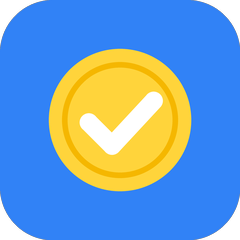
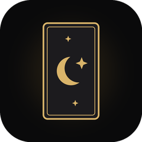
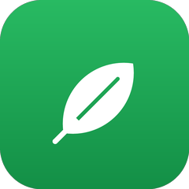
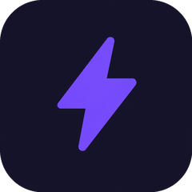

  

  <b>백색소음처럼, 곁에 있는 줄도 모르게 편안한 서비스를 만들어요.</b> 
  Creating calm and comfortable experiences like white noise

 

## 작업실

백색소음본부는 작은 서비스를 빠르게 만들고, 쓰는 사람의 하루에 조용히 스며드는 걸 목표로 하는 작업실이에요.
매일 한 번 열어 보는 습관 앱, 반려동물과 함께하는 앱, 개발자를 위한 작은 도구를 만들어요.

 

## 토스 미니앱

토스 앱 안에서 설치 없이 바로 쓰는 [앱인토스](https://developers-apps-in-toss.toss.im/) 미니앱이에요.

<table width="100%">
  <tr>
    <td align="center" width="33%">
        
      <b>오늘 무지출 했나요</b> 
      돈 안 쓴 날을 기록하는 절약 챌린지  
      <a href="https://github.com/whitenoise-hq/zero-spend">레포 보기</a>
    </td>
    <td align="center" width="33%">
        
      <b>오늘 타로</b> 
      매일 아침 카드 한 장 타로  
      <a href="https://github.com/whitenoise-hq/onul-tarot">레포 보기</a>
    </td>
    <td align="center" width="33%">
        
      <b>오늘 물 줬나요</b> 
      식물마다 매일 체크하는 물주기 기록  
      준비 중
    </td>
  </tr>
</table>

 

## 반려동물 앱

<table width="100%">
  <tr>
    <td align="center" width="50%">
        
      <b>포포노트</b> 
      가족이 함께 쓰는 반려동물 AI 다이어리  
      <a href="https://poponote.devwoodie.com">웹사이트</a> · <a href="https://github.com/whitenoise-hq/poponote">레포 보기</a>
    </td>
    <td align="center" width="50%">
        
      <b>포포스탯</b> 
      우리 아이의 숨은 전투력 측정기  
      <a href="https://github.com/whitenoise-hq/popostat">레포 보기</a>
    </td>
  </tr>
</table>

 

## 도구

| 이름 | 설명 |
|---|---|
| [Git TIERS](https://github.com/whitenoise-hq/git-tiers) | 매일의 커밋으로 올라가는 GitHub 티어 · [웹사이트](https://git-tiers.devwoodie.com) |
| [app-dev-playbook](https://github.com/whitenoise-hq/app-dev-playbook) | 앱을 만들 때마다 쓰는 공통 문서 모음 |

 

## 만드는 방식

  
  
  
  
  
  
  

- 작게 만들고 빨리 내놓아요. 써 보는 사람의 반응을 보고 다음을 정해요.
- 서버 없이 되는 건 서버 없이 만들어요. 기록은 가능한 한 사용자 기기에 둬요.
- 화면은 조용하게. 꼭 필요한 것만 남겨요.

 

  작업실 <a href="https://github.com/whitenoise-hq">백색소음본부</a>

